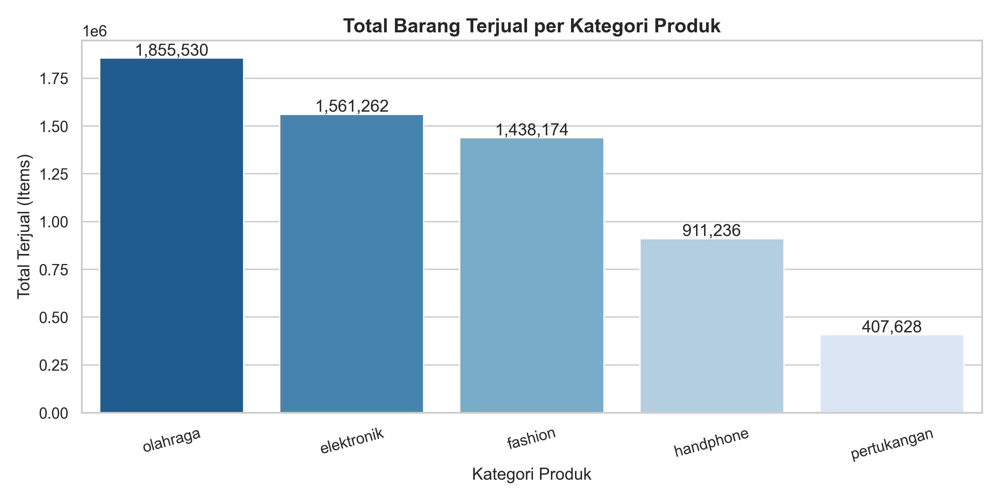

# 🛍️ Tokopedia E-Commerce Sentiment & Category Performance Analysis



## 📌 Executive Summary
Project data analisis ini bertujuan untuk mengevaluasi performa penjualan dan kepuasan pelanggan pada **3.664 produk** dari **158 toko/seller** di platform Tokopedia. Analisis mencakup akumulasi **6,17+ juta item terjual** di 5 kategori utama (Elektronik, Fashion, Handphone, Olahraga, dan Pertukangan).

---

## 📊 Key Performance Indicators (KPIs)
- **Total Items Sold:** 6,173,830 items
- **Average Rating:** 4.64 / 5.00
- **Total Unique Products:** 3,664 products
- **Total Shops Analyzed:** 158 shops

---

## 📑 Project Presentation Layout (Portfolio Presentation)

### Slide 1: Overview & Scope
| Bagian | Keterangan |
| :--- | :--- |
| **Penjelasan Diri** | Data Analyst / Full-Stack Web Developer |
| **Tentang Project** | Analisis performa kategori, distribusi rating, dan sentimen ulasan produk Tokopedia. |
| **Informasi Perusahaan** | **Tokopedia** — E-Commerce / Marketplace (5 Kategori: *Elektronik, Fashion, Handphone, Olahraga, Pertukangan*). |
| **Tools Used** | Python (`pandas`, `matplotlib`, `seaborn`), VS Code, Jupyter Notebook, Looker Studio, Canva. |

---

### Slide 2: Analysis & Business Impact

#### 🔴 Problem Statement
Manajemen dan penjual (*sellers*) memerlukan gambaran yang jelas mengenai kategori produk mana yang mendominasi volume transaksi, serta sejauh mana ulasan negatif (*negative sentiment*) berdampak pada potensi kerugian penjualan.

#### ⚙️ Methodology
1. **Data Cleaning & Formatting:** Penanganan duplikasi, nilai kosong, serta standardisasi tipe data numerik.
2. **Sentiment Classification:** Pengelompokan ulasan pelanggan berdasarkan skala rating:
   - **Positive:** Rating $\ge 4$
   - **Neutral:** Rating $= 3$
   - **Negative:** Rating $\le 2$
3. **Aggregation & Exploratory Data Analysis (EDA):** Perhitungan akumulasi penjualan (`sold`) dan rata-rata rating per kategori.

#### 📈 Key Results
- **Kategori Terlaris:** Kategori **Olahraga** mencatatkan transaksi terbanyak (**1.719.090 item** pada ulasan positif), disusul oleh **Elektronik** (**1.506.329 item**) dan **Fashion** (**1.359.710 item**).
- **Dominasi Sentimen Positif:** Lebih dari **85%** total penjualan didorong oleh produk dengan rating tinggi ($\ge 4.0$).
- **Area Risiko:** Kategori **Handphone** mencatatkan jumlah transaksi ber-ulasan *Negative* terbanyak (**47.457 item** dengan rata-rata rating **1.38**), mengindikasikan adanya isu kualitas produk atau layanan pascabeli.

#### 💡 Business Impact & Recommendations
- **Optimasi Inventaris & Promosi:** Alokasikan porsi anggaran kampanye pemasaran dan stok barang lebih besar pada kategori *Olahraga*, *Elektronik*, dan *Fashion*.
- **Evaluasi Quality Control (QC):** Lakukan evaluasi khusus pada seller/produk di kategori *Handphone* untuk meminimalisir ulasan negatif yang berpotensi merusak reputasi platform.

---

## 🛠️ Project Structure
```text
tokopedia-sentiment-analysis/
├── data/
│   ├── raw/                 # Raw dataset dari Kaggle
│   └── processed/           # Dataset hasil cleaning (CSV)
├── notebooks/
│   ├── 01_data_exploration_and_cleaning.ipynb
│   ├── 02_sales_and_category_analysis.ipynb
│   ├── 03_sentiment_and_review_analytics.ipynb
│   └── 04_executive_summary_and_export.ipynb
├── outputs/
│   ├── figures/             # Export grafik & chart (.png)
│   └── reports/             # Summary metrics & KPI (.csv)
├── setup.py
├── generate_notebooks.py
└── README.md